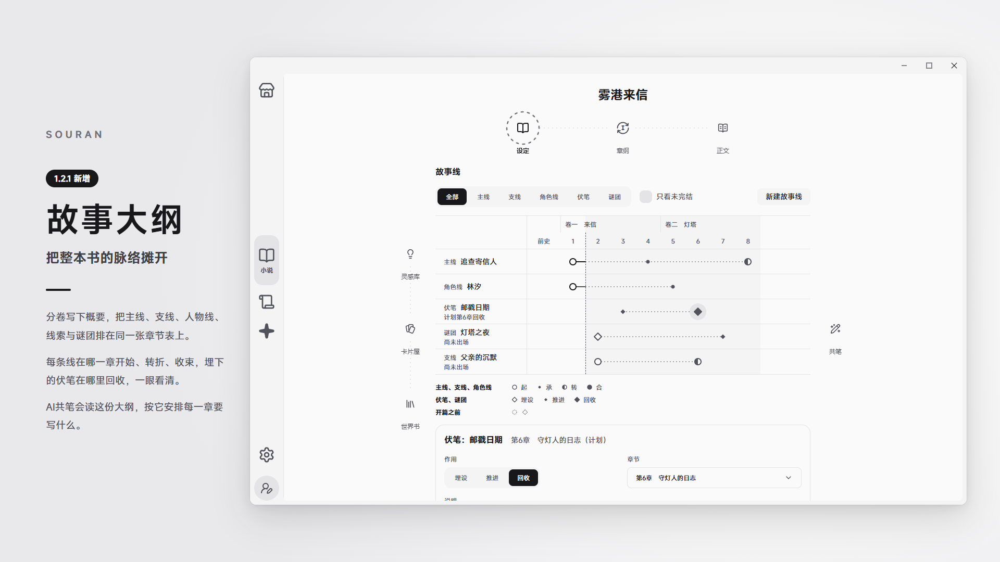
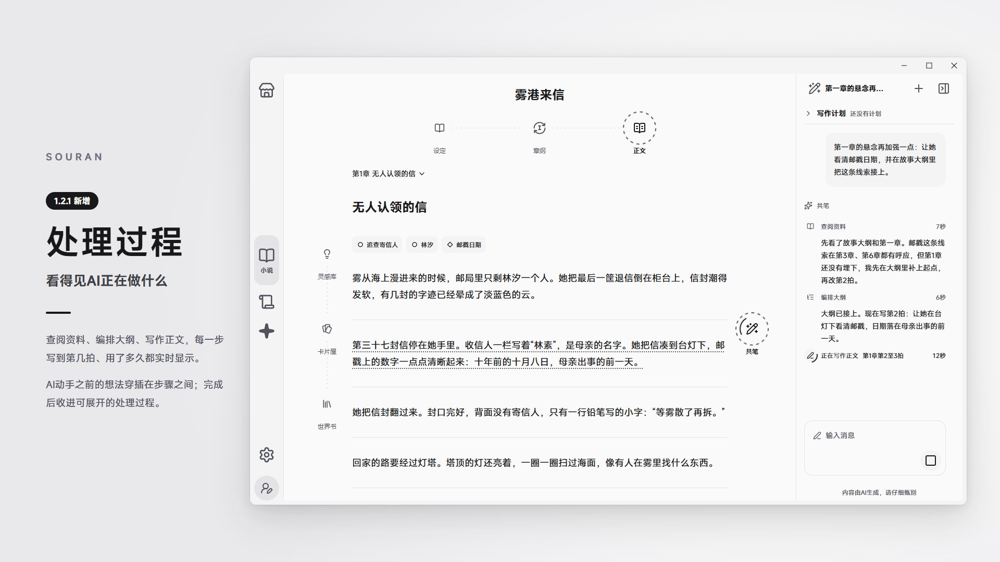
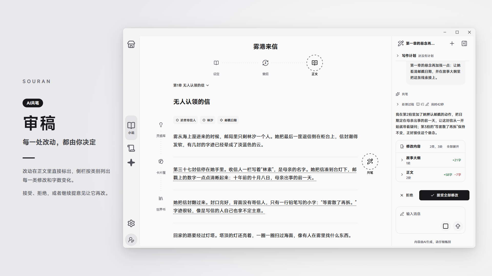
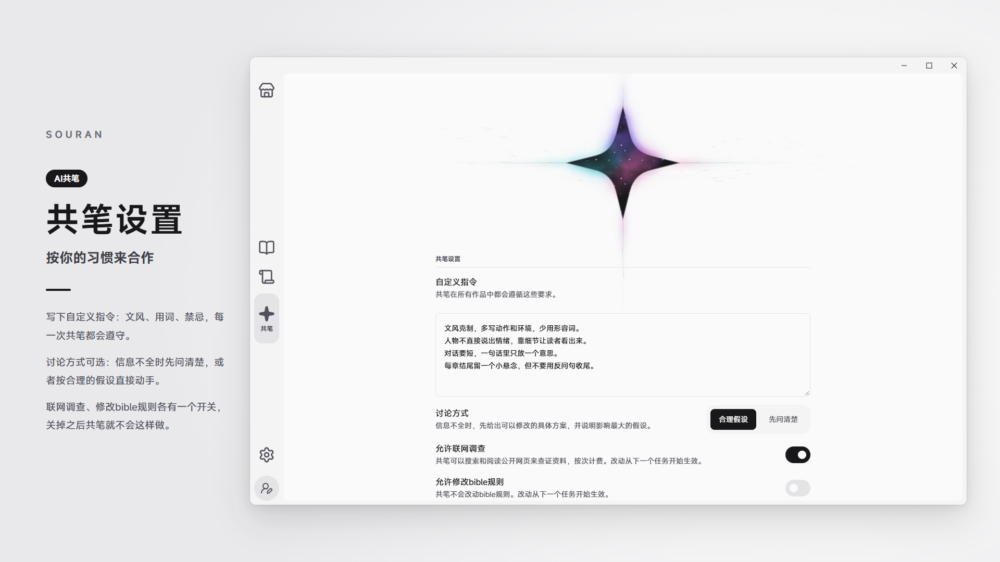
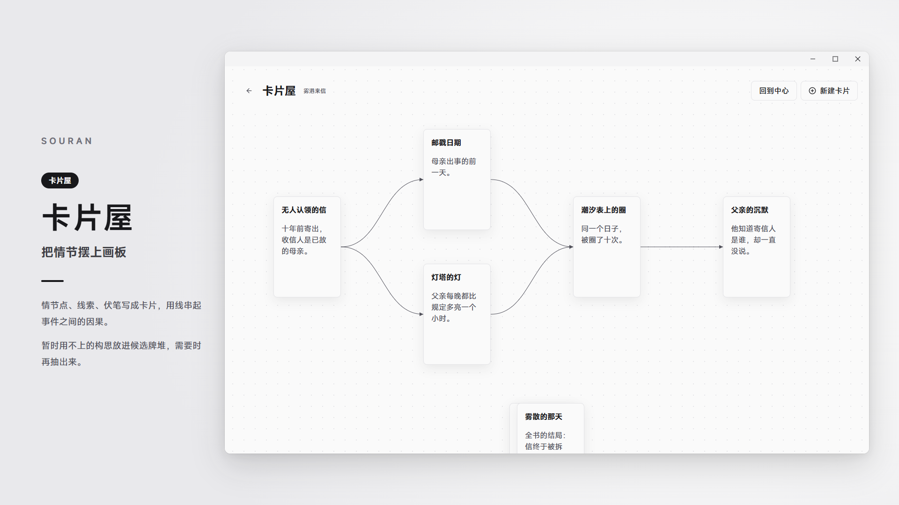
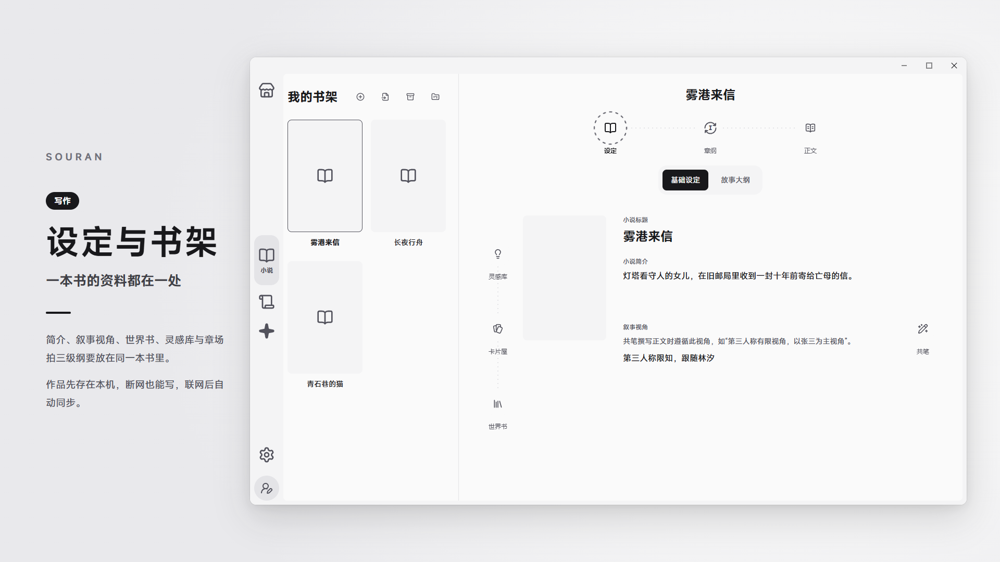

# SOURAN

SOURAN是一款为长篇小说写作设计的Windows桌面软件。它把设定、故事大纲、纲要、正文、灵感和世界书放在同一本书里，并提供一位AI共笔：它能读完全书，按你的要求修改，每一处改动都先交给你审阅。

- **[下载最新版本](https://github.com/asahanadadesu/souran/releases/latest)**
- **[购买订阅与点数（链动小铺）](https://wzyp.cn/shop/SOURAN)**

## 故事大纲

- 总纲写下一句话故事、核心冲突和结局走向；“开篇之前”记录正文开始前就已发生的事。
- 分卷写概要，每一卷到哪一章为止都可以调整；后面的卷可以先规划，暂不分章。
- 主线、支线、角色线、伏笔、谜团排在同一张章节表上。每条线在哪一章开始、转折、收束，伏笔在哪一章埋下、推进、回收，一眼看清；还没回收的伏笔会单独提示。
- 正文页顶部显示本章要推进的故事线，写的时候不会忘。
- AI共笔会读这份大纲，按它安排每一章的内容，也可以按你的要求修改大纲。

## AI共笔

订阅后，前往“共笔”页，点击页面上部的巨大四芒星，即可开启AI共笔。

- 在侧栏里用平常的话提出要求，比如“第二拍再写细一点”“帮我把这一章的冲突理清楚”。
- AI会查阅你的设定、故事大纲、纲要、世界书和前文，再动手修改。它能改正文，也能改故事大纲、纲要、设定、世界书、灵感和卡片屋。
- 处理过程实时显示：查阅资料、编排大纲、写作正文，每一步写到第几拍、用了多久都看得见；AI动手前的想法也穿插在步骤之间。完成后收进可以展开的“处理过程”。

- 所有修改都先交给你审阅：改动处在正文里标出，侧栏按类别列出每一类修改和字数变化。接受、拒绝，或者继续提意见让它再改，决定权在你。
- 写作计划：长篇可以先和AI一起列出分步计划，批准后逐项执行，每一步完成都由你确认。

- 自定义指令：写下你的文风、用词习惯和禁忌，共笔在所有作品中都会遵守。
- 讨论方式：信息不全时，可以让它先问清楚，也可以让它按合理的假设直接给出方案。
- 联网调查：打开后，需要查资料时它会搜索和阅读公开网页，回复里附带来源链接；关掉后只使用作品里的资料。
- 修改bible规则：默认关闭，打开后才会按你的要求改动作品的规则。

## 卡片屋

把情节点、线索、伏笔写成卡片，摆在画板上用线串起来，看清事件之间的因果。暂时用不上的构思放进候选牌堆，需要时再抽出来。

## 写作

- 章、场、拍三级纲要：先列出每章的场景，再把场景拆成一拍一拍的情节；正文按拍书写，随时回到纲要调整结构。
- 整章或逐拍编辑：可以像普通文稿一样整章连续写，也可以逐拍对照纲要写。
- 设定与世界书：小说的简介、叙事视角，以及人物、地点、组织等世界书条目。世界书条目可以按章节分阶段，记录同一角色在不同时期的状态。
- 灵感库：随手记下的片段和参考资料，写作和共笔时随时取用。

## 你的作品

- 本机优先：作品先保存在你的电脑上，断网时仍然可以写；联网后自动同步到云端，换电脑登录同一账号即可继续。
- 导出与备份：随时把作品导出为TXT、Markdown，或者完整的SOURAN备份文件；备份文件可以在本机恢复成一部新作品，不需要联网。
- AI与隐私：只有在使用AI共笔时，相关的设定和正文才会发送给AI模型服务处理。

## 订阅

写作功能注册后即可使用。AI共笔需要订阅：

- 在[链动小铺](https://wzyp.cn/shop/SOURAN)购买月付订阅或点数包，付款后会收到卡密。
- 在SOURAN的订阅页输入卡密兑换，订阅天数或点数立即到账。
- 订阅每天有一份额度，北京时间0点重置；当天额度用完后，消耗点数包的额度池，额度池永不过期。

## 下载与安装

1. 打开 [Releases](https://github.com/asahanadadesu/souran/releases/latest)，下载 `Souran-<版本号>-setup.exe`。
2. 双击安装。安装在当前用户目录下，不需要管理员权限。
3. SOURAN目前暂未购买代码签名证书，Windows可能提示“Windows已保护你的电脑”。点击“更多信息”，再点“仍要运行”即可。每个版本的说明里都附有安装包的SHA-256，可以用来核对下载的文件是否完整。
4. 安装后，用邮箱注册账号并登录。之后有新版本时，SOURAN会自动下载并更新。

系统要求：Windows 10或Windows 11（64位）。

## 当前状态

“剧本”相关功能尚在开发中，敬请期待。

## 关于本仓库

SOURAN是一款闭源软件，本仓库仅用于介绍SOURAN和发布安装包。
