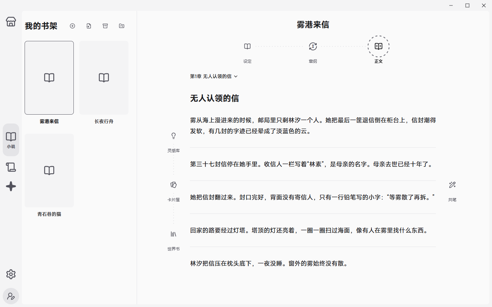
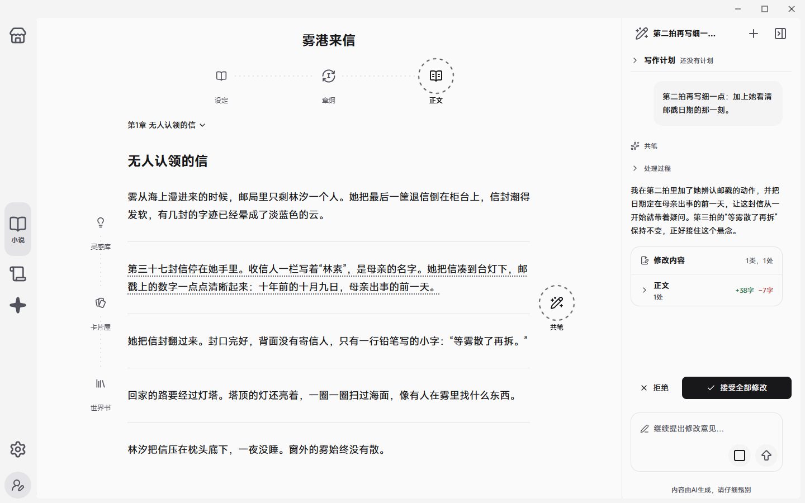
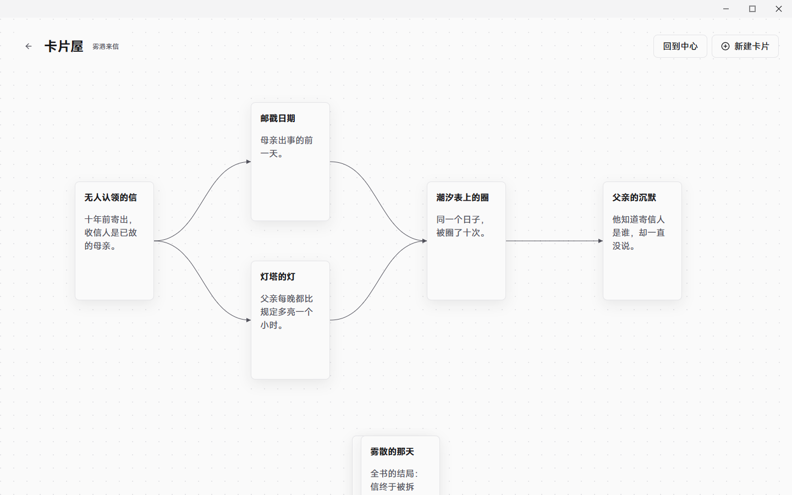
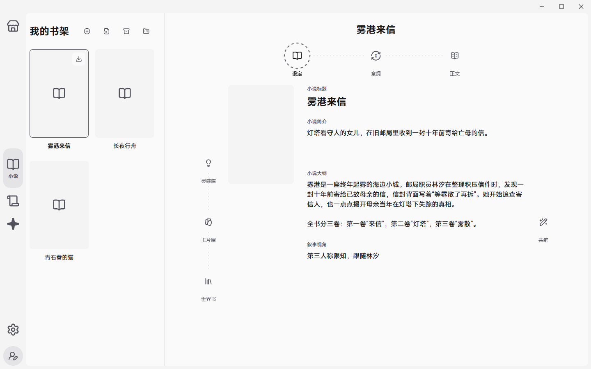

# SOURAN

SOURAN是一款为长篇小说写作设计的Windows桌面软件。它将设定、纲要、正文、灵感和世界观资料集成在一本书中，并提供一位能读完全书、按照您的要求修改、每处改动都先交给您审阅的AI共笔。

- **[下载最新版本](https://github.com/asahanadadesu/souran/releases/latest)**
- **[在爱发电支持SOURAN](https://afdian.com/a/asahanada)**

## 写作

- 章、场、拍三级纲要：先列出每章的场景，再把场景拆成一拍一拍的情节；正文按拍书写，随时回到纲要调整结构。
- 整章或逐拍编辑：可以像普通文稿一样整章连续写，也可以逐拍对照纲要写。
- 设定与世界书：小说的简介、大纲、叙事视角，以及人物、地点、组织等世界书条目。世界书条目可以按章节分阶段记录同一角色在不同时期的状态。
- 灵感库：随手记下的片段和参考资料，写作和共笔时随时取用。

## AI共笔

- 在侧栏里用平常的话提出要求，比如“第二拍再写细一点”“帮我把这一章的冲突理清楚”。
- AI会查阅你的设定、纲要、世界书和前文，再动手修改。它能改正文，也能改纲要、设定、世界书、灵感和卡片屋。
- 所有修改都先交给您审阅：改动处在正文里标出，侧栏列出每一类修改的字数变化。接受、拒绝，或者继续提意见让它再改，决定权在你。
- 写作计划：长篇可以先和AI一起列出分步计划，批准后逐项执行，每一步完成都由您确认。
- 联网调查：需要查资料时，经您授权后会联网，回复里附带来源链接。

## 卡片屋

把情节点、线索、伏笔写成卡片，摆在画板上用线串起来，看清事件之间的因果。暂时用不上的构思放进候选牌堆，需要时再抽出来。

## 书架与设定

## 你的作品

- 本机优先：作品会先保存在您的电脑上，断网时仍然可以写；联网后自动同步到云端，换电脑登录同一账号即可继续。
- 导出与备份：随时把作品导出为TXT、Markdown，或者完整的SOURAN备份文件；备份文件可以在本机恢复成一部新作品，不需要联网。
- AI与隐私：只有在使用AI共笔时，相关的设定和正文才会发送给AI模型服务处理。

## 下载与安装

1. 打开 [Releases](https://github.com/asahanadadesu/souran/releases/latest)，下载 `Souran-<版本号>-setup.exe`。
2. 双击安装。安装在当前用户目录下，不需要管理员权限。
3. SOURAN目前暂未购买代码签名证书，Windows可能提示“Windows已保护你的电脑”。点击“更多信息”，再点“仍要运行”即可。每个版本的说明里都附有安装包的SHA-256，您可用来核对下载的文件是否完整。
4. 安装后，用邮箱注册账号并登录。之后有新版本时，SOURAN会自动下载并更新。

系统要求：Windows 10或Windows 11（64位）。

## 当前状态

SOURAN正处于小范围测试阶段。写作功能注册后即可使用；AI共笔需要订阅，订阅方式将会在[爱发电主页](https://afdian.com/a/asahanada)公布。

“剧本”相关功能尚在开发中，敬请期待。

## 关于本仓库

SOURAN是一款闭源软件，本仓库仅用于介绍SOURAN和发布安装包。